# Extension B2Brouter (Wanamics)

Cette extension permet de connecter votre application Business Central à la Plateforme Agréée (PA) B2Brouter pour recevoir et/ou émettre des factures électroniques.

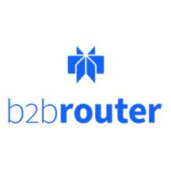

**Sommaire**
- [Contexte](#contexte)
- [Cas d'usage (usecase)](#cas-dusage-usecase)
- [Souscription](#souscription)
  - [Création d'un compte B2Brouter](#création-dun-compte-b2brouter)
  - [Abonnement](#abonnement)
  - [Clés API](#clés-api)
  - [Bacs à sable (sandbox)](#bacs-à-sable-sandbox)
  - [Environnement de qualification (**Staging**)](#environnement-de-qualification-staging)
  - [Initialisation](#initialisation)
  - [Ajouter un utilisateur](#ajouter-un-utilisateur)
  - [Remarques](#remarques)
  - [Modification de votre abonnement](#modification-de-votre-abonnement)
- [Portail B2Brouter](#portail-b2brouter)
- [Installation](#installation)
- [Configuration Business Central](#configuration-business-central)
- [Utilisation](#utilisation)
- [Factures reçues](#factures-reçues)
- [Factures émises](#factures-émises)
- [Administration](#administration)
- [Modèle de données](#modèle-de-données)
  - [Table(s) ajoutée(s)](#tables-ajoutées)
  - [Table(s) étendue(s)](#tables-étendues)
  - [Enumération(s) étendue(s)](#enumérations-étendues)

## Contexte
La fonctionnalité **Documents électroniques** de Business Central est composée d'un module générique (E-Document Core) auquel vient se greffer un (voire plusieurs) connecteur adapté à la localisation et/ou au prestataire de service (**Plateforme Agréée** en France). 

Voir aussi 
https://learn.microsoft.com/fr-fr/dynamics365/business-central/finance-how-setup-edocuments-external

[Extending the e-documents functionality - Business Central | Microsoft Learn](https://learn.microsoft.com/fr-fr/dynamics365/business-central/dev-itpro/developer/devenv-extend-edocuments)

[B2Brouter](https://www.b2brouter.net/fr/) est une Plateforme Agréee (PA) pour laquelle Microsoft propose un connecteur [E-Document Connector - B2Brouter](https://marketplace.microsoft.com/fr-FR/product/dynamics-365-business-central/PUBID.microsoftdynsmb%7CAID.e-documents-connector-b2brouter%7CPAPPID.b4305a63-f987-425b-8520-ca9ccf7b22b6) 
 

Cependant à ce jour (version BC28 2026 wave 1), il s'avère incomplet et déjà obsolète (la version de l'API utilisée est encore v2025-01-01, soit 4 versions de retard...).
En particulier, il ne gère pas le cycle de vie de la facture (statuts) !

Ce connecteur Microsoft étant OpenSource (licence MIT), Wanamics en a décliné une variante (les ID objets sont translatés de +80000, de la plage 6490..6499 à 86490..86499). 

Cette variante ne demande qu'à disparaître lorsque l'extension d'origine sera opérationnelle.
Les données propres à l'extension (très limitées, voir Modèle de données) pourront alors être transférées.

Notez que l'application **Connector B2BRouter** éditée par **B2Brouter Global, S.L.** proposée sur **AppSource** n'est pas disponible en France ('The extension is not available for your country').

## Cas d'usage (usecase)

La réforme de la facture électronique (RFE) a recencé les cas d'usages (42 à ce jour), mais une Plateforme Agréée n'est pas tenue de tous les prendre en compte.

Voir le liste des cas traités par B2Brouter : https://docs.b2brouter.net/en/developers/guides-by-country/france/fr-supported-use-cases

Vous noterez que la pluspart des cas sont traités ou le seront très prochainement, à l'exception des modalités propres aux marchés de travaux (paiement direct, co-traitance...) qui ont à ce jour (sept. 2026) le statut *Evaluation*.

## Souscription

Voir aussi [Manuel d'autoapprovisonnement eDocExchange](https://acrobat.adobe.com/id/urn:aaid:sc:EU:9a1fb95f-ccc3-45bf-8715-09d85397440e) 

### Création d'un compte B2Brouter
Utilisez le lien https://app.b2brouter.net/fr/register et complétez les informations requises pour créer le compte : 

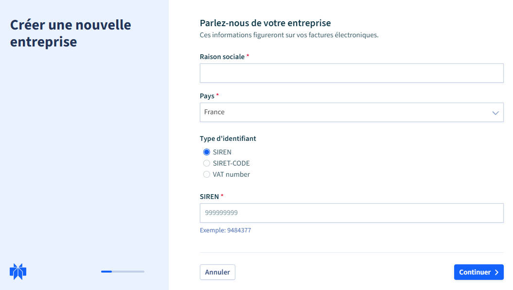

### Abonnement

Après la page d'authentification, choisissez l'option Intégration (**eDocExchange**)
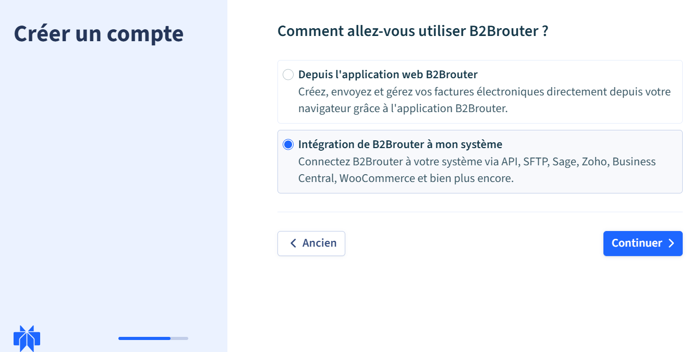

Choississez un palier selon la volumétrie (1 transaction par document reçu, 2 par document emis) : 

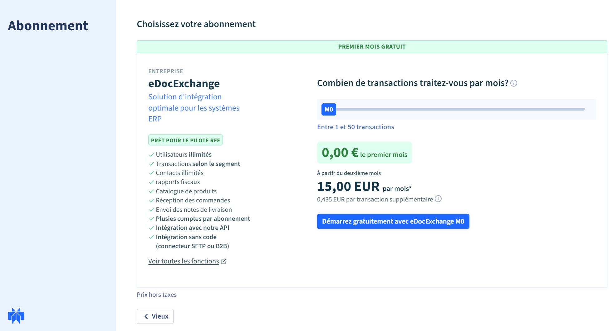

Notez que le tarif unitaire est dégressif et que prix d'un document supplémentaire correspond au tarif unitaire.

Ce palier pourra évoluer d'un mois à l'autre si nécessaire (à la hausse comme à la baisse).

Extrait des [Conditions Générales de B2Brouter] (https://www.b2brouter.net/fr/conditions-generales-du-service/)

Voir en particulier :\
**3.4 eDocExchange**\
eDocExchange permet de gérer plusieurs comptes dans le cadre d’un même abonnement, moyennant un coût fixe supplémentaire pour chaque compte ajouté. Chaque compte est rattaché à une seule entreprise, et les entreprises pouvant être ajoutées à un même abonnement doivent appartenir au même groupe corporatif.
L’abonnement au service est établi en fonction du nombre de transactions souscrites pour une période déterminée. Les transactions peuvent être consommées librement pendant ladite période à compter de la date d’activation. Si le CLIENT dépasse le volume souscrit, les transactions excédentaires seront facturées à la fin de la période, conformément au tarif en vigueur. Les transactions non consommées durant la période de validité ne feront l’objet d’aucun remboursement.

Le CLIENT recevra des notifications sur le niveau de consommation atteint et pourra, s’il le souhaite, changer de palier avant d’atteindre la limite maximale.

**Conditions de changement de paliers**

Un seul changement de palier est autorisé par période souscrite.
En cas de demande de diminution de palier, le changement ne pourra se faire qu’au palier immédiatement inférieur.
Le changement de palier prendra effet au moment où l’utilisateur confirmera le nouveau palier, ce qui impliquera la mise à jour de la date d’abonnement et la facturation immédiate du montant correspondant.
Dans le cas où, au moment du changement de palier, un dépassement de transactions serait constaté par rapport à la limite du palier précédent, ce dépassement sera facturé avec le prix du nouveau palier.

8. DURÉE ET RENOUVELLEMENT (12 mois renouvellable par tacite reconduction ou résul)

Procédez alors au paiement (par prélèvement ou carte bancaire) : 
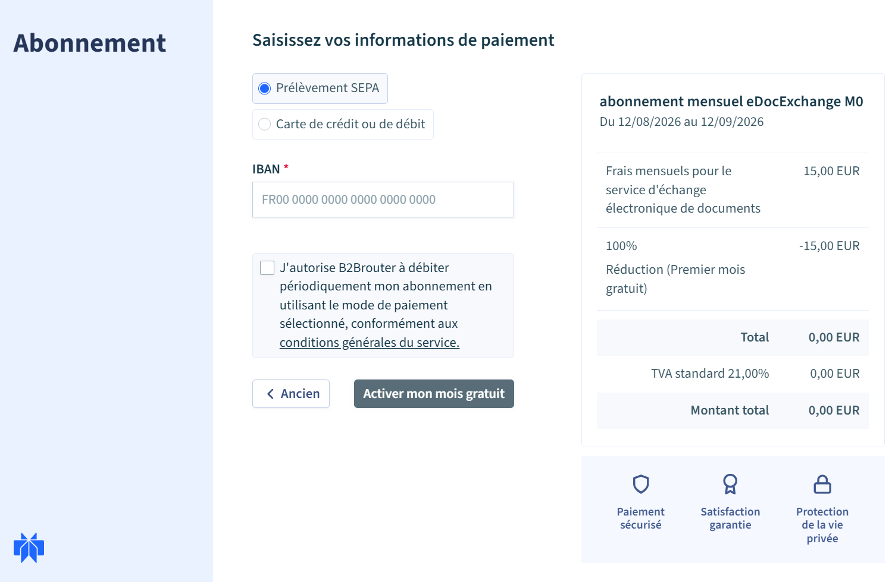

L'inscription se termine par une page à partir de laquelle vous pourrez **Afficher la clé API** (View API Key)** : 

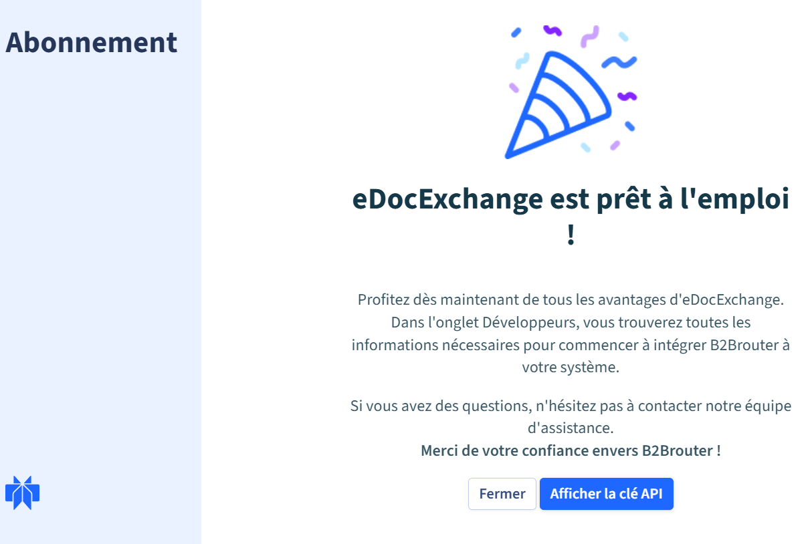

 Enregistrez-là en lieu sûr et ne la divulguez pas.
 Notez également l'**Identifiant de compte** qui vous a été attribué.
 Vous aurez-besoin de ces informations pour configurer le connecteur dans Business Central.
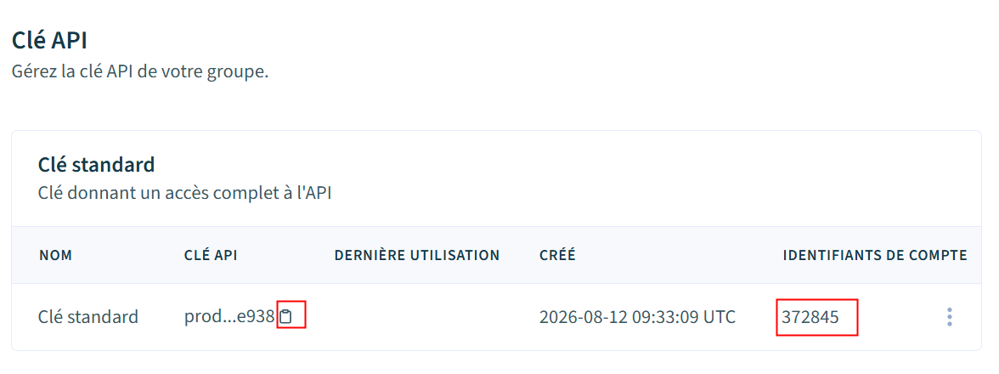

Cette clé pourra être renouvellée si nécessaire (via le menu 3 points en bout de ligne) et devra alors être reportée à la configuration Business Central.
Notez que seul le propriétaire du compte peut la voir ou la renouveler.

### Clés API 

Outre la clé API standard, des clés restreintes peuvent être crées pour leur associer des autorisations distinctes.

Les clés de production (standard ou restreintes) ont le préfixe prod_.
Elles ne sont visibles que par le compte Propriétaire (via la page Développeurs).

Il pourra les renouveller si nécessaire (via le menu 3 points en bout de ligne) et devra alors la mettre à jour dans la configuration du connecteur.

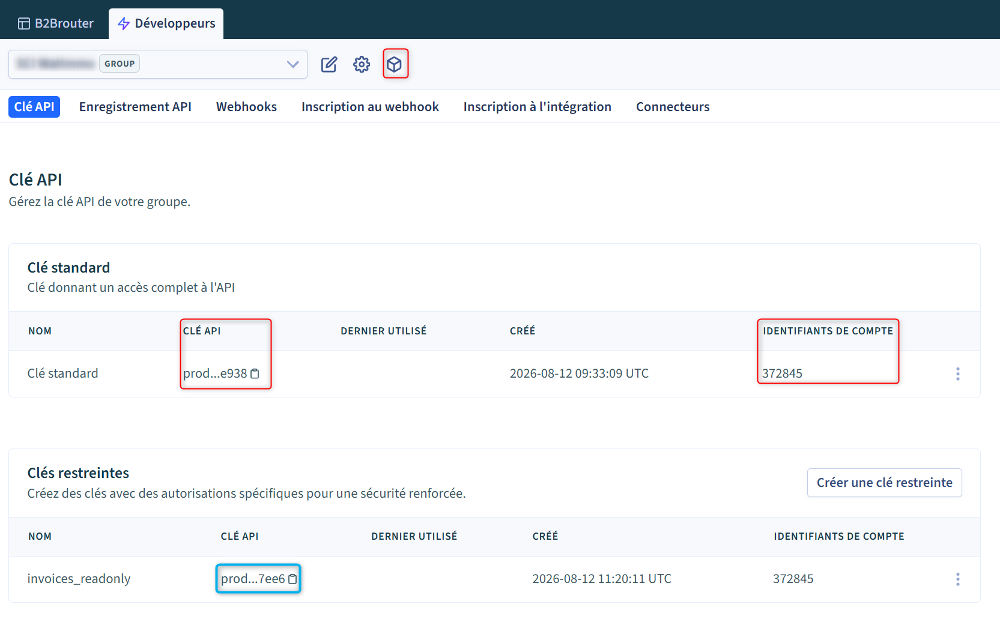.

### Bacs à sable (sandbox)

Par ailleurs, des environnements *Bac à sable* (5 maximum) peuvent être créés à l'intiative des développeurs, via l'icône 'cube'.

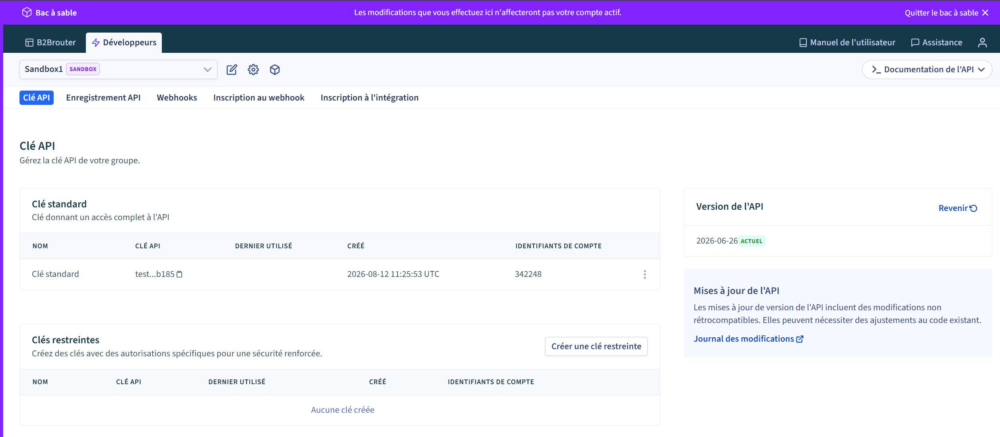

L'accès à un environnempent bac à sable est identifiable au pourtour mauve et à l'action **Quitter le bac à sable** en haut à droite.
Les clés API (standard ou resteintes) d'un environnement *bac à sable* ont le préfixe *test_*.

Les environnements bacs à sable (destinés à la simulation) sont 'confinés' (sans lien avec l'extérieur). Leurs fonctionnalités sont restrenites et ils ne peuvent en particulier ni recevoir ni émettre aucun document (voir [B2Brouter Sandbox](https://docs.b2brouter.net/en/developers/testing/sandbox/))

Des documents peuvent y être créés via le portail (saisis ou importés) ou par une API distincte (voir connecteur Business Central).

Ainsi, vous pourrez : 
* Vérifier qu'une facture émise depuis Business Central y a bien été intégrée, sans risquer de la transmettre à votre client et à l'administration.
* Simuler une facture reçue (saisie ou importée depuis une facture-X) pour vérifier que le **Document électronique** correspondant a bien été créé.
* Vérifier que les changements de statut sont bien  répercutés.

Un environnement sandbox dispose de 3 contacts de tests créés automatiquement : 
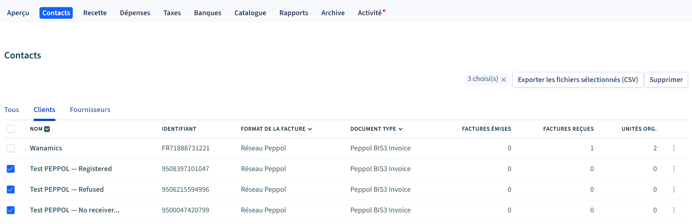

Vous pourrez ainsi créer des documents et simuler différents cas : 
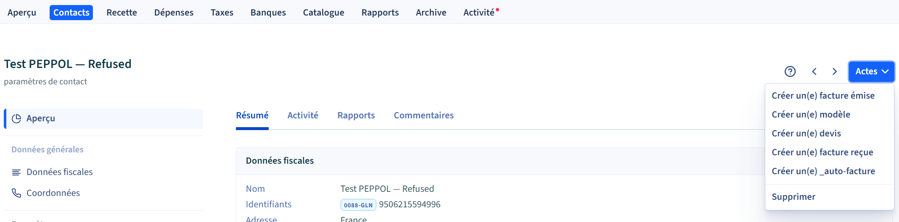

Vous pouvez les créer dans Business Central et tant que client et/ou fournisseur, en veillant à reprendre leur N° de TVA fictif (préfixe 95).

### Environnement de qualification (**Staging**)

B2Brouter permet également de créer des environnements de **Staging** à ne pas confondre avec les environnements **bacs à sable** (ou **sandbox**) décrits ci-dessus.

Le mode **Staging** est destiné à des tests de bout en bout tels que ceux réalisés pour la qualification de la plateforme (voir [B2Brouter Docs]( https://docs.b2brouter.net/en/developers/testing/environments/?_gl=1*shkm25*_up*MQ..*_ga*ODExMjIwOTgzLjE3ODY1Mzk2Nzg.*_ga_QNSMRMFD37*czE3ODY1Mzk2NzgkbzEkZzAkdDE3ODY1Mzk2NzgkajYwJGwwJGgw#staging--for-large-or-broad-integrations ))

Il s'agit en quelque sorte d'une préversion permettant par exemple de tester des fonctionnalités qui ne seraient pas encore publiées dans l'environnement de production.

### Initialisation

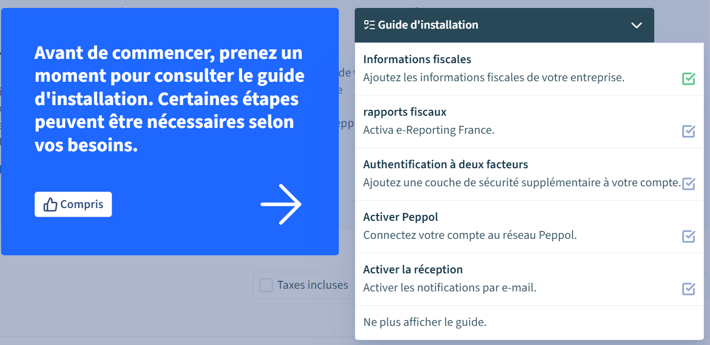

Vous pouvez alors déclarer B2Brouter comme Plateforme Agréée (une alerte vous indique la marche à suivre si vous en aviez préalablement déclarer une autre).

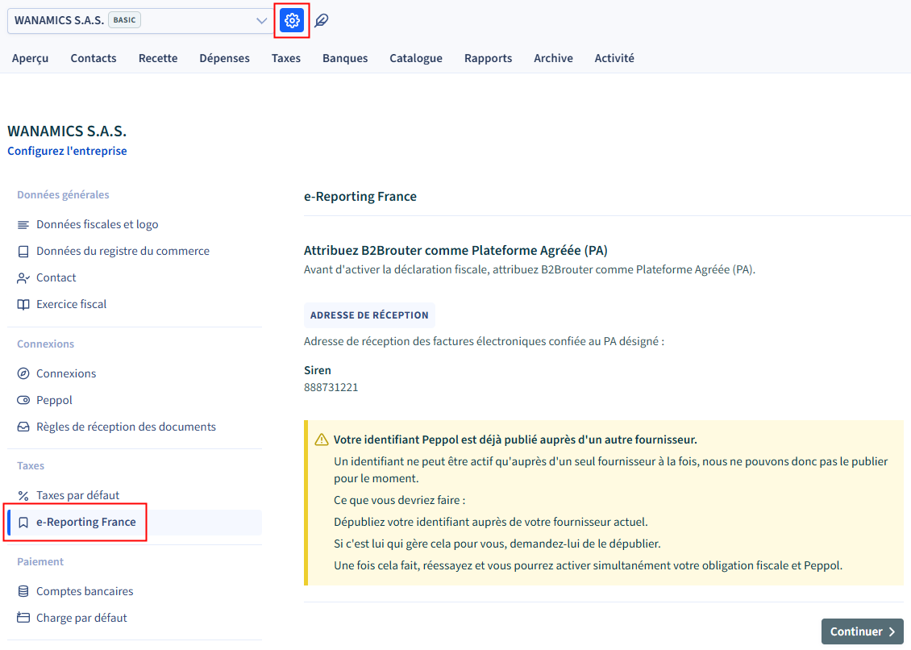

Vous devrez fournir les documents de vérification de l'identité de l'entreprise (extrait Kbis...). 

### Ajouter un utilisateur

Il peut être utile d'ajouter votre partenaire préféré en tant qu'administrateur pourqu'il puisse vous assister si nécessaire.

Cependant, cela ne lui est pas nécessaire pour configurer Business Central et échanger des documents, dès lors que vous aurez configuré la clé API et le compte B2Brouter tel que décrit ci-après.

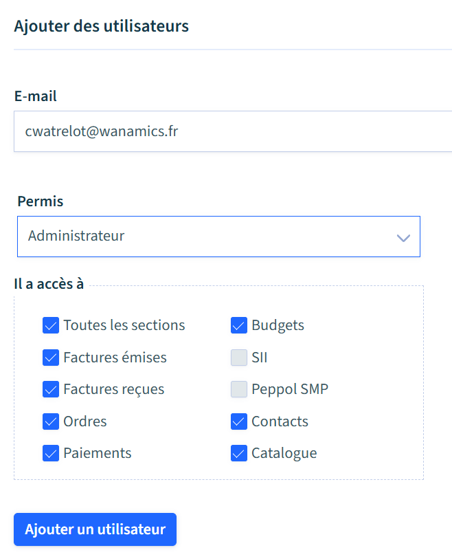

Ce nouvel utilisateur recevra un mail d'invitation et deviendra **Actif** lorsqu'il l'aura acceptée : 

Notez que chaque utilisateur pourra modifier la langue d'affichage : 
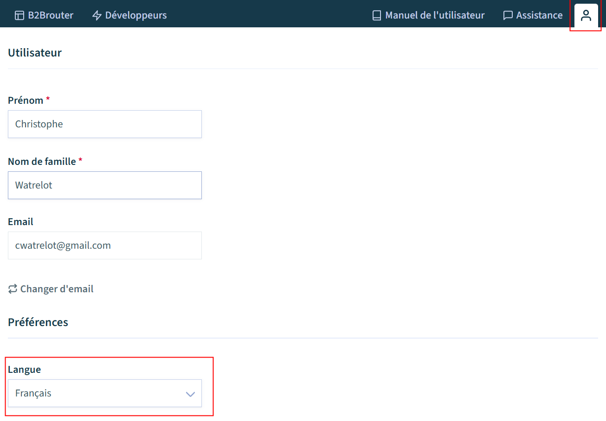

### Remarques
* Un compte peut avoir plusieurs utilisateurs et un même utilisateur peut avoir accès à plusieurs comptes.

* Un même compte peut être utilisé pour plusieurs sociétés d'un même groupe, permettant ainsi de mutualiser l'abonnement B2Brouter et la volumétrie souscrite.
* Un compte n'a qu'un seul propriétaire (celui qui a créé le compte par défaut).\
Il est cependant possible de transférer la propriété à un autre utilisateur.*

### Modification de votre abonnement

Pour modifier voire annuler votre abonnement B2Brouter, sélectionnez l'entreprise puis cliquez sur l'icône 'plume'.

La page **Abonnement actuel** propose une action **Changer de section** (ou palier, une seule fois par mois maximum et d'un seul palier à la baisse).
Via le volet menu, ouvrez la page **Renouvellement et paiement** (ou via l'URL suivante en précisant {{entreprise}}
https://app.b2brouter.net/projects/{{entreprise}}/subscription_renew

## Portail B2Brouter
Le portail B2Brouter (https://app.b2brouter.net/) permet de recevoir et/ou émettre des factures électroniques 'manuellement' (sans intégration à votre logiciel).

Dans le cas présent, ces fonctions n'ont aucun sens et risqueraient de faire doublon avec les factures reçues et/ou émises via le connecteur.

Vous n'en aurez donc pas besoin mais pouvez cependant le consulter pour superviser les documents échangés : 
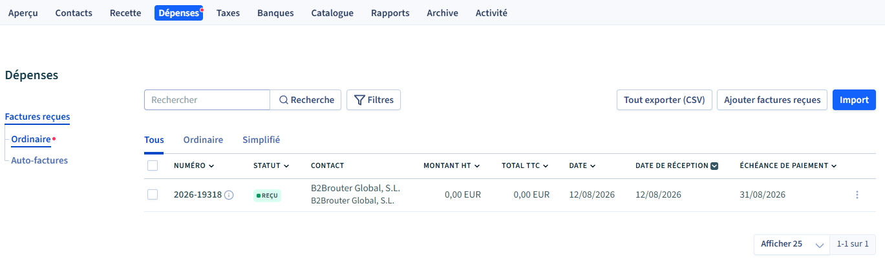

Vous pouvez d'ailleurs constater que la première facture électronique reçue (onglet Dépenses) n'est autre que celle de B2Brouter ! 

L'onglet *Activité* vous permettra de consulter les *Transactions*, le *Journal des évènements* et les *Erreurs d'importation*.

Les liens (en haut à droite) vous seront de peu d'intérêt: 
* Le *Manuel de l' utilisateur* (en angais ou en espagnol) concerne le portail que vous n'utiliserez que très ponctuellement.
* L'*Assistance* de B2Brouter n'est pas responsable du connecteur Business Central. Vous pourrez cependant consulter le blog (en français et sur des sujets porpres à la facture électronique en France) : https://www.b2brouter.net/fr/blog/
* L'accès à votre *Profil* vous permettra de sélection choisir la **Langue** *Français* 

## Installation

**Prérequis**

Les extensions *E-Document Core* et *E-Reporting FR* doivent être préalablement installées : 
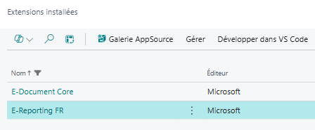

Importez alors l'extension comme toute autre extension de type **Per Tenant Extension** (PTE) puis **Autoriser les demandes http client** :
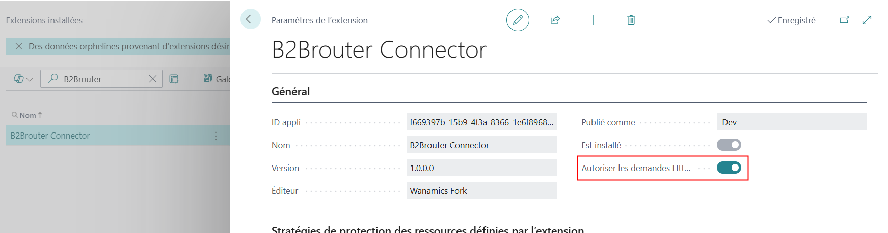

## Configuration Business Central
Recherchez la liste des **Services documents électroniques** (ou y accéder depuis la liste **Documents électroniques**) pour y ajouter un service comme suit : 

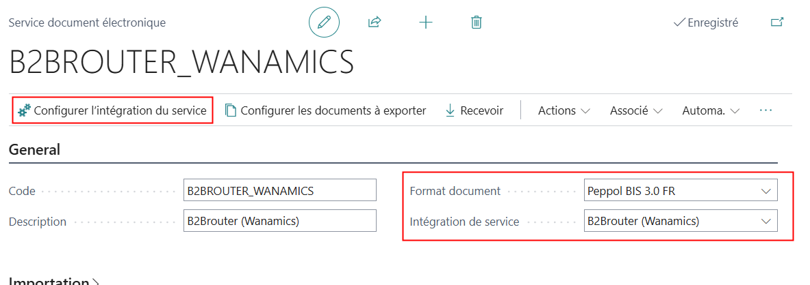

Optez pour **Intégration de service** *B2Brouter (Wanamics)* :

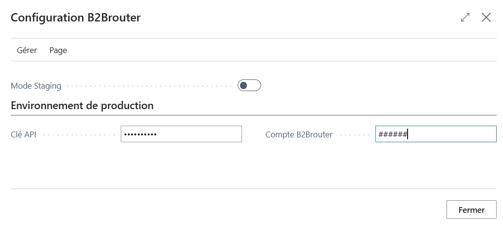

**Attention**
L'activation du **Mode Staging** 

## Utilisation

Le connecteur B2Brouter n'est qu'une implémentation du connecteur générique (E-Document Core).

La réception et/ou l'émission des factures électoniques ne présente pas de particularité.

Seules les quelques améliorations apportées sont décrites ci-après.

## Factures reçues

!!! Lien B2Brouter ID et affichage du document (ou factbox ?)

!!! Historique de statuts

## Factures émises

Idem

## Administration

Lors de la crétion d'un environnement *Sandbox* de Business Central (à ne pas confondre avec les **bacs à sable** de B2Brouter), le mode Staging du connecteur est activé pour éviter d'imppacter involontairement l'environnement de production de B2Brouter.
Pour connecter l'environnement sandbox de Business Central à un environnement **bac à sable** de B2Brouter, il faut attribuer la clé API correspondante (de préfixe test_).
!!! A revoir : selon environnement Production ou Sandbox de BC ?

## Modèle de données

### Table(s) ajoutée(s)

|Name|Description| 
|-|-|
|B2Brouter Setup|Configuration du connecteur|

### Table(s) étendue(s)

|TableName |FieldName |Description|
|-|-|-|
|E document|B2Brouter File Id|ID du document correspondant dans B2Brouter|

### Enumération(s) étendue(s)
|Enum|Valeur|
|-|-|
|Service integration|B2Brouter (Wanamics)|

